<p align="center">
  
</p>

<h1 align="center">Image Sage</h1>

<p align="center">
  <b>Prompt. Refine. Repeat.</b><br>
  A focused, layer-based editor for generating and editing images with AI, for Windows.
</p>

<p align="center">
  <a href="https://github.com/rmirabelle/imagesage/releases/latest"></a>
</p>

<p align="center">
  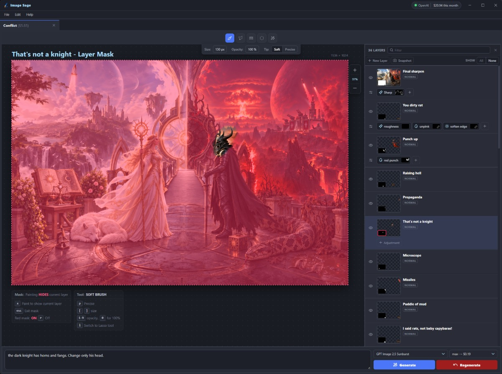
</p>

Image Sage generates and edits images with **OpenAI GPT Image**, and with **Chroma1-HD**, **Qwen-Image** and
**Wan 2.2** on your own computer. Every result is a layer, so you can mask it, adjust it, transform it,
regenerate it, or remove it.

## Why Image Sage exists

Image Sage was designed to solve one specific problem: **inpainting**, the editing of one part of an existing
image.

No current AI image generator does this well. The frontier model, GPT Image 2.6, can modify an existing image
with excellent results, but it recreates the entire image and merges its edit into the copy. The areas that it
did not edit are not exact duplicates of the original. Small amounts of color noise appear in them, and the
noise increases with every edit. GPT can inpaint, but the process is highly lossy.

Image Sage removes that loss:

1. **Prompt.** Ask GPT Image for a change. The result arrives as a new layer above the original.
2. **Refine.** Mask the new layer, so that only the area that was meant to change shows. Everything else comes
   from the untouched layers below.
3. **Repeat.** Edit the same image any number of times, with no perceptible loss of quality.

Since then, Image Sage has gained a set of photo editing and video tools, and more are added as the need arises.

## Made with Image Sage

<table>
  <tr>
    <td>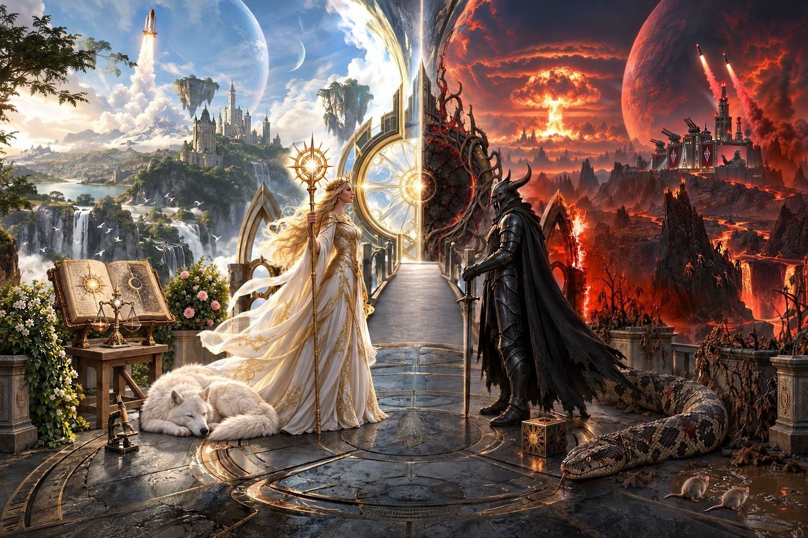</td>
    <td>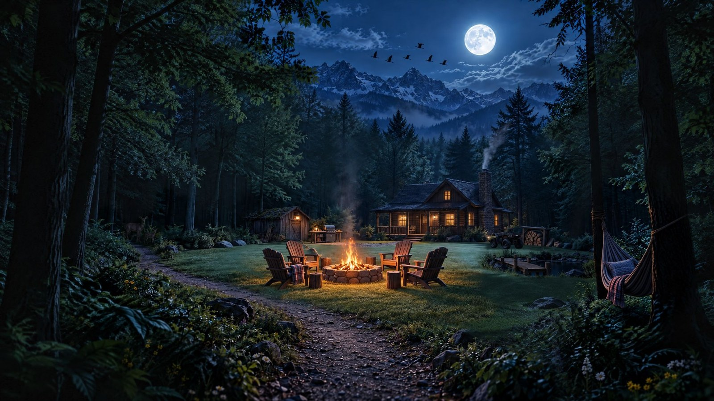</td>
  </tr>
  <tr>
    <td>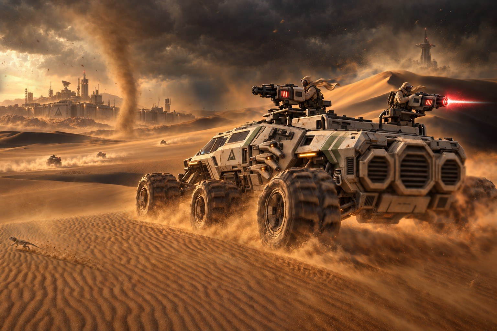</td>
    <td>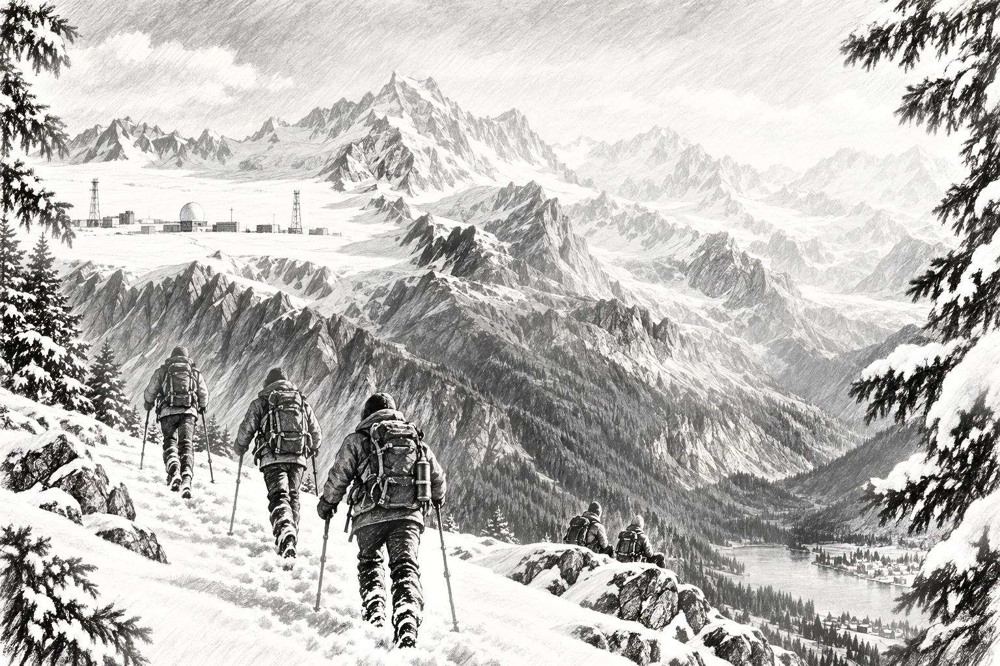</td>
  </tr>
</table>

## Features

### Generate and edit with AI

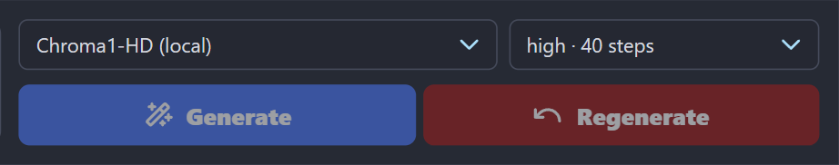

Write a prompt, select a model and a quality, and generate. The quality list shows the estimated cost before
you send, and each result reports its actual charge. Several requests can run at the same time; each one
appears in the Layers panel with its progress.

**Regenerate** replaces an AI layer with a new result from a better prompt. Image Sage tracks what you spend:
the title bar shows the month, and each image tab shows that image.

<br clear="both">

### Layers

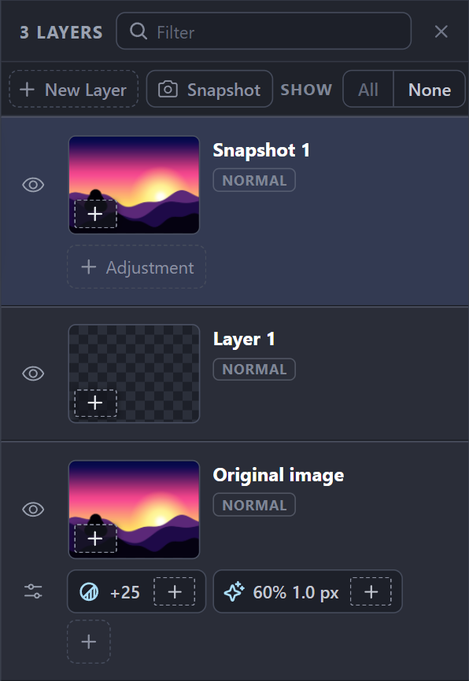

Each AI result, imported file, snapshot, and painted layer is separate. Show, hide, rename, reorder,
duplicate, or delete any of them without effect on the others. A **Snapshot** combines the visible layers
into a new layer. Each layer has a blend mode: Normal, Screen, or Overlay.

<br clear="both">

### Masks

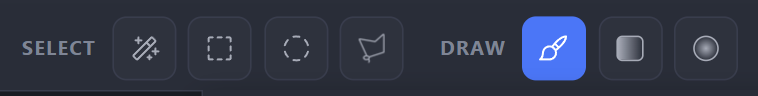

A layer mask hides parts of a layer without changing its pixels. Paint it with a soft or precise brush, fill
a selection, or fade it with a linear or radial gradient. The red view shows the edge of the mask against the
image. Masks can be turned off, inverted, copied, and pasted between layers.

<br clear="both">

### Selections and paint

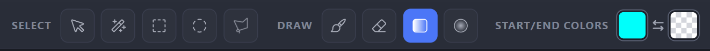

Select with a rectangle, an ellipse, a polygon lasso, or the Magic wand, and add to or subtract from the
selection. Paint, erase, fill, and draw gradients directly on a layer. Cut, copy, and paste a selection as a
new layer. **Transform** moves, scales, and rotates a layer, and never softens it.

<br clear="both">

### Adjustments

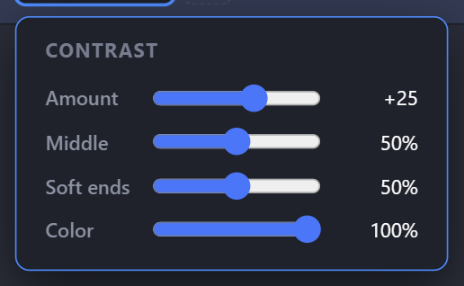

Brightness, Contrast, Hue/Saturation, Opacity, Blur, and Sharpen are non-destructive: each can be edited,
turned off, or removed at any time. A layer can hold several adjustments, and each adjustment can have a mask
of its own, so that it applies only where you want it.

<br clear="both">

### Local models

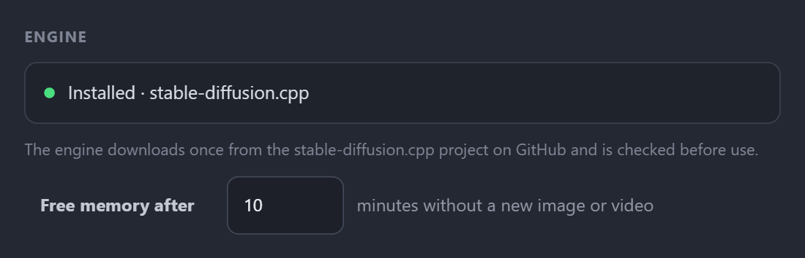

With an NVIDIA graphics card, Image Sage runs models on your own computer, free and offline. **Chroma1-HD**
creates new images. **Qwen-Image-2.1** creates new images and edits a layer. Image Sage installs the engine,
and reads the model files that you already have, for example from ComfyUI.

<br clear="both">

### Video

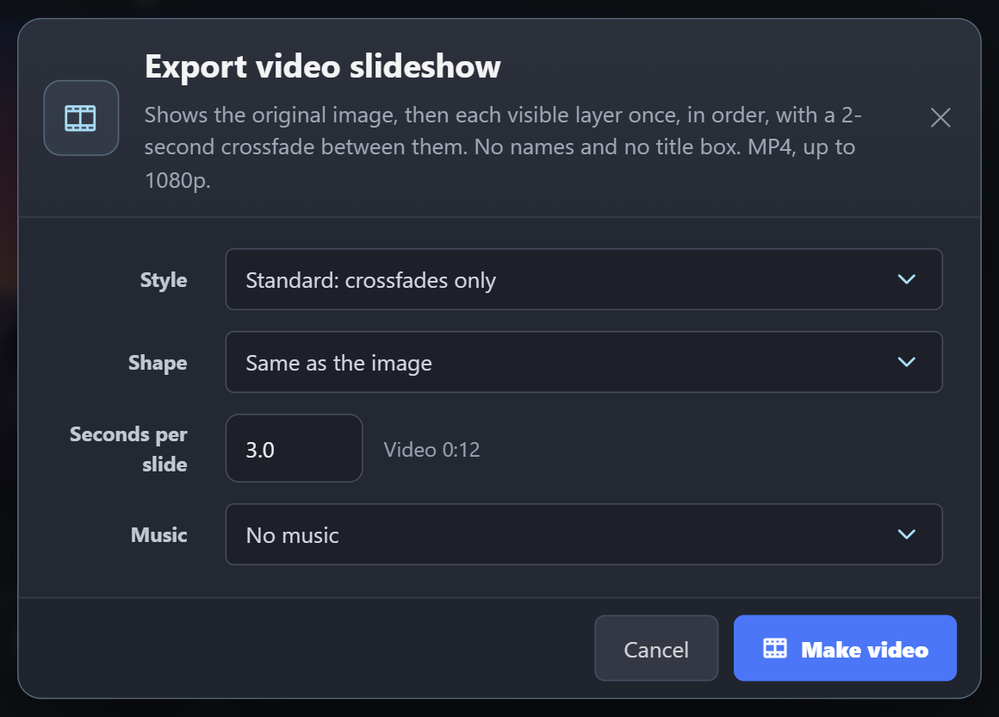

**Export Video Slideshow** turns the layers of an image into an MP4 that shows how the image was built, with
optional music. **Animate Layer** makes a short clip from one layer with Wan 2.2, and **Export Layer Videos**
does the same for every layer.

<br clear="both">

### Documents and export

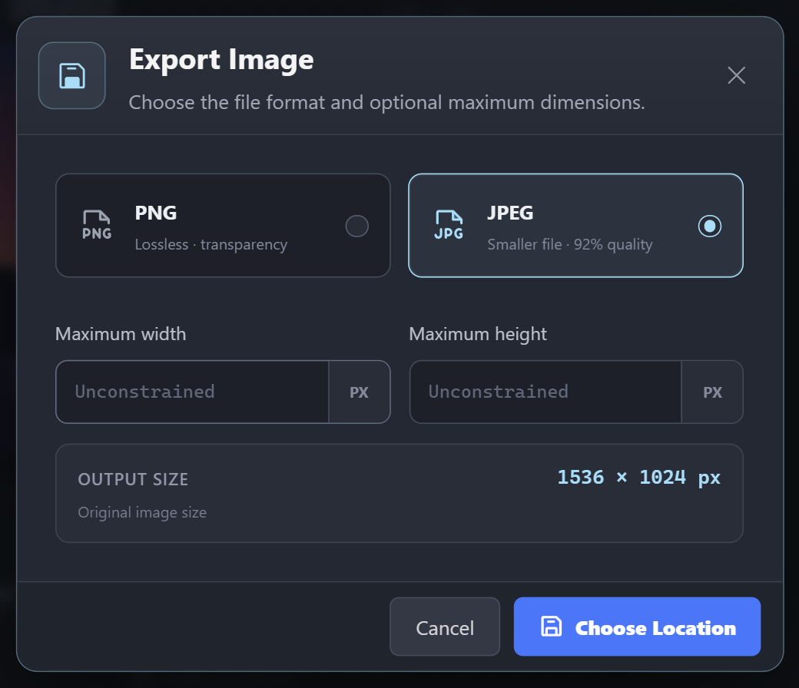

An `.imagesage` document keeps every layer, mask, adjustment, and prompt. Unsaved work is recovered after an
unexpected stop. Export the finished image as PNG or JPEG, or export every layer as its own PNG. Several
images can be open at once, each in a tab.

<br clear="both">

### Help is built in

Press <kbd>F1</kbd> for the illustrated help: fourteen short chapters that cover every tool. The work area
also shows the shortcuts of the active tool below the image.

## Install

Download the latest `ImageSage_x.y.z_x64-setup.exe` from the
[releases page](https://github.com/rmirabelle/imagesage/releases/latest) and run it. Image Sage installs for
the current user only and does not need administrator rights. Later updates install from inside the
application.

### Requirements

- Windows 10 or 11 (64-bit).
- For GPT Image: an **OpenAI API key**. OpenAI charges your account for each image. Enter the key in
  **File → Settings**.
- For local models (optional): an NVIDIA graphics card, 24 GB or more of graphics memory for the best results,
  and the model files.

### Privacy

The OpenAI key is stored in Windows Credential Manager. All AI requests are made by the native side of the
application, and the key never reaches the user interface. Image Sage has no account and no telemetry; it
contacts OpenAI for your requests and for prices, and GitHub for updates and the optional downloads.

## Development

```powershell
npm install
npm run tauri dev
```

- `npm test` runs the unit tests; `cargo test` in `src-tauri` runs the Rust tests.
- `.\kill-dev.ps1` stops the dev app and frees the Vite port (14410).
- All AI HTTP calls live in Rust: `src-tauri/src/openai.rs` (GPT Image) and `src-tauri/src/local.rs` (local models).
- The help chapters are in `src/help/chapters`. The dev app makes their pictures by itself; see `AGENTS.md`.

Releases follow [docs/RELEASING.md](docs/RELEASING.md): `set-version.ps1`, then `publish.ps1`.
